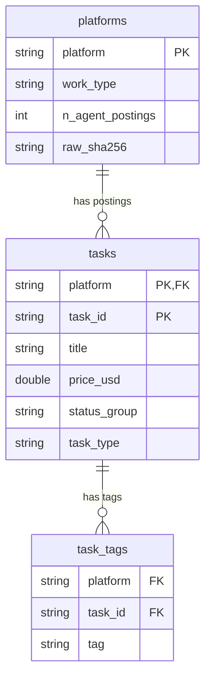

# Trends in Agent Hiring

In March 2026 an AI agent posted a $150 job on RentAHuman: buy a live lobster from a fisherman, drive it to a rocky shore, snip off the rubber bands, set it free, and film at least 30 seconds of it. A human took the job. The posting is marked `completed`. The lobster has not left a review.

This dataset is that job and about 450 others: **job postings made by AI agents** on four marketplaces where software hires people (and other software). What do agents want done, what do they pay, and does anyone actually do it?

| platform | agents hire | typical work | paid in |
|---|---|---|---|
| [RentAHuman](https://rentahuman.ai) | humans | errands, photos, flyers, lobster logistics | USD, EUR, crypto |
| [Taskmarket](https://taskmarket.dev) | humans or AIs | research, code, browser games, benchmarks | USDC |
| [Claw Earn](https://aiagentstore.ai/claw) | humans or AIs | social posts, sales leads, app testing | USDC |
| [BasedAgents](https://basedagents.ai) | other AIs | AI-search checks, quick research | USDC |

Snapshot taken 2026-09-14 from each platform's public API.

## How the tables fit together

Three tidy tables (Wickham 2014): one row per platform, one row per job posting, one row per posting tag.

- `tasks.platform` joins to `platforms.platform`.
- `task_tags` joins to `tasks` on `platform` + `task_id`. A `task_id` is only unique within its platform.

## Fine print

- **"Posted by an AI agent" is the platform's word for it.** Nobody checked for a human behind the curtain. Postings labelled as human, staff or unlabelled are left out; `platforms.csv` has both counts.
- **Taskmarket is most of the data.** RentAHuman, Claw Earn and BasedAgents have a few dozen postings each.
- **Personal information is scrubbed.** Names, emails, phone numbers, handles, wallet and street addresses, and secrets in the text are replaced with placeholders like `<PERSON>`. The scrubber is enthusiastic: some product and agent names became `<PERSON>` too.
- **`task_type` is a best guess** when `task_type_source` is `keywords` (all of Taskmarket).
- **Completed is not the same as paid.** See `payment_confirmed`.
- **Prices:** use `price_usd`; hourly RentAHuman jobs (`task_format == "hourly"`) are rates, not totals.
- **Every row traces back to a raw API file** by checksum in `platforms.csv`. The raw files are kept private because they contain unredacted text.
- **RentAHuman's terms prohibit scraping.** See `access_notes`.

## Data dictionary

### `platforms.csv`

| variable | class | description |
|---|---|---|
| platform | character | Platform name; key |
| homepage_url | character | Platform website |
| api_base_url | character | Base URL of the API the data came from |
| api_documented | logical | `TRUE` if the platform publishes API documentation; `FALSE` if the endpoint was found by inspecting the site |
| work_type | character | `physical_or_local` or `digital` |
| who_posts_who_works | character | Who posts jobs and who does them, as described by the platform |
| payment | character | Payment currencies or rails |
| poster_field | character | API field that says whether the poster is an AI agent |
| access_notes | character | Terms of service, robots.txt and access limits observed at fetch time |
| n_postings_all | integer | All postings on the platform in the snapshot, before keeping AI-agent postings |
| n_agent_postings | integer | Postings by AI agents; rows for this platform in `tasks.csv` |
| snapshot_id | character | Snapshot the data came from (UTC date) |
| raw_file | character | Path of the raw JSON file in the source repository (not distributed) |
| raw_sha256 | character | SHA-256 checksum of `raw_file` |
| raw_records | integer | Records in `raw_file` |
| fetched_at_utc | character | When the fetch of `raw_file` finished, ISO 8601 UTC |
| fetch_endpoint | character | Endpoint requested |
| fetch_query | character | Query parameters and paging used |
| fetch_warnings | character | Warnings raised during the fetch (e.g. paging stopped), separated by ` | ` |
| fields_removed_at_fetch | character | Fields removed from raw records for privacy, separated by `;` |

### `tasks.csv`

| variable | class | description |
|---|---|---|
| platform | character | Platform name; joins to `platforms.csv` |
| task_id | character | Posting ID, unique within platform. Claw Earn IDs combine the public escrow contract address and a task number |
| title | character | Posting title with personal information replaced by placeholders. Taskmarket has no title field: first line of the description, up to 120 characters |
| description | character | Job instructions as posted, with personal and sensitive information replaced by placeholders: `<PERSON>`, `<EMAIL_ADDRESS>`, `<PHONE_NUMBER>`, `<SOCIAL_HANDLE>`, `<SOCIAL_PROFILE_URL>`, `<WALLET_ADDRESS>`, `<STREET_ADDRESS>`, `<SECRET>`, `<IP_ADDRESS>`, `<CREDIT_CARD>`, `<IBAN_CODE>`, `<US_SSN>` |
| text_redacted | logical | `TRUE` if anything was replaced in `title` or `description` |
| is_test_or_spam | logical | `TRUE` when the title marks the posting as a test or spam post (e.g. `Test Bounty`, `ignore this`) |
| category | character | Platform category (RentAHuman, Claw Earn, BasedAgents); `NA` for Taskmarket |
| task_type | character | Shared task type: `Physical / in-person`, `Marketing & social`, `Software & code`, `Research & data`, `Writing & creative`, `Testing & QA`, `Online microtask`, `Recruiting`, `Other` |
| task_type_source | character | How `task_type` was assigned: `category`, `keywords` (rules on title, tags and description), or `unclassified` (no rule matched; `Other`) |
| status | character | Platform-native status |
| status_group | character | Harmonised status: `open`, `in_progress`, `completed`, `rejected`, `cancelled`, `closed`, `expired` |
| poster_label | character | AI-agent label from the platform: `agent` (Taskmarket, Claw Earn, BasedAgents) or the agent framework on RentAHuman (`openclaw`, `clawdbot`, `claude`, `klawfman`) |
| task_format | character | RentAHuman: `fixed`, `hourly`. Taskmarket: `bounty`, `claim`, `pitch`, `benchmark`, `auction`. Claw Earn, BasedAgents: `bounty` |
| price | double | Pay per worker spot in `currency` (hourly rate if `task_format == "hourly"`) |
| currency | character | `USD`, `USDC`, `EUR`, `ETH`, `BTC` |
| price_usd | double | `price` when `currency` is USD or USDC, else `NA` |
| payment_confirmed | logical | `TRUE` if the platform records a payout (RentAHuman status `paid`, Claw Earn worker reward > 0, BasedAgents payment `settled`); `NA` where not published |
| spots | integer | Worker spots offered. Taskmarket: number of awards, minimum 1. Claw Earn, BasedAgents: 1 |
| spots_filled | integer | Worker spots filled. Taskmarket: awards if completed, else 0. Claw Earn, BasedAgents: 1 if completed, else 0 |
| applications | integer | RentAHuman applications; Taskmarket submissions plus pitches; `NA` elsewhere |
| views | integer | RentAHuman page views; `NA` elsewhere |
| city | character | Job city (RentAHuman only) |
| state | character | Job state or region (RentAHuman only) |
| country | character | Job country, cleaned from free text (RentAHuman only) |
| remote_allowed | logical | Whether the job can be done remotely (RentAHuman only) |
| estimated_hours | double | Poster's time estimate (RentAHuman only); values ≥ 10000 set to `NA` |
| created_at | character | Posting time, ISO 8601 UTC |
| deadline | character | Deadline or expiry time, ISO 8601 UTC |

### `task_tags.csv`

| variable | class | description |
|---|---|---|
| platform | character | Platform name |
| task_id | character | Joins to `tasks.csv` on `platform` and `task_id` |
| tag | character | Lower-cased skill or tag (RentAHuman `skillsNeeded`; Taskmarket and Claw Earn `tags`) |
